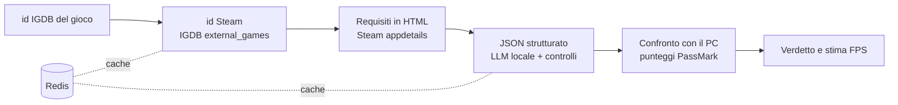

# "Posso farlo girare?"

Funzione aggiuntiva, fuori dall'elenco dei bonus del subject: l'utente salva le specifiche del suo PC e, nella pagina di un gioco, l'app gli dice **se il gioco gira** e **con quanti FPS circa**, per ogni preset grafico e risoluzione.

## Come funziona, in breve



1. Il frontend chiama `GET /api/compat/can-i-run?gameId=<id IGDB>`.
2. Il backend trova l'id Steam del gioco tramite IGDB.
3. Scarica da Steam i requisiti minimi e consigliati. Steam li fornisce come testo libero in HTML, per esempio `Processor: Intel Core i5-4460 or AMD FX-6300`.
4. Un **LLM locale** (Ollama con `qwen3:8b`) trasforma il testo in JSON. Il codice poi controlla ogni valore e scarta quelli inventati.
5. CPU e GPU dell'utente e dei requisiti si confrontano tramite i **punteggi PassMark**.
6. Dal confronto escono il verdetto (consigliati / minimi / non gira / sconosciuto) e una tabella di FPS stimati.

I passi 2 e 4 sono lenti (rete e LLM), quindi i risultati restano in cache su Redis per 30 giorni.

## Scelte e alternative scartate

| Scelta | Perché |
| --- | --- |
| **Requisiti da Steam** | IGDB non ha i requisiti di sistema. Steam li ha per quasi tutti i giochi PC, con un'API pubblica senza chiave (`appdetails`). |
| **Niente servizi "Can You Run It"** | Non hanno un'API pubblica, i termini d'uso vietano lo scraping, e danno solo un sì/no, senza FPS. |
| **LLM solo per leggere il testo** | Il testo di Steam non ha un formato fisso: un parser a regole si rompe al primo gioco scritto in modo diverso. All'LLM chiediamo solo di estrarre i dati, mai il verdetto: il verdetto lo calcola il codice con regole che si possono leggere e verificare. |
| **LLM locale (Ollama) invece di un'API cloud** | Gratis, nessun dato inviato a terzi, gira nello stesso `docker compose`. Con una GPU NVIDIA un gioco si estrae in pochi secondi. |
| **Niente modello addestrato** | Per addestrare un modello servirebbero migliaia di coppie (PC, gioco, FPS misurati), che non abbiamo. Una formula con poche costanti si può tarare anche con pochi dati. |
| **Punteggi PassMark** | Classifiche con migliaia di CPU e GPU, comprese quelle vecchie citate nei requisiti dei giochi. Le abbiamo copiate in `data/hardware/` e convertite in JSON. Non esiste un'API gratuita: i dati sono usati solo a scopo didattico. |
| **FPS in fasce** | La stima ha un margine d'errore (vedi [Precisione](#precisione)). Oltre al numero diamo la fascia (`60-90`, `90-144`...), che è più onesta. |

## File

Tutti nel worktree `app/02_backend`:

| File | Cosa fa |
| --- | --- |
| `query/pcSpecs.ts` | Salva e legge le specifiche del PC (colonna `pc_specs`, vedi [Database.md](Database.md)) |
| `app/api/specs/add-specs/route.ts` | `POST`: valida e salva le specifiche |
| `app/api/specs/get-specs/route.ts` | `GET`: le restituisce |
| `app/api/specs/delete-specs/route.ts` | `DELETE`: le cancella |
| `app/api/compat/can-i-run/route.ts` | `GET`: verdetto e stima per un gioco |
| `lib/igdb-api/steam-app.ts` | Da id IGDB a id Steam, con cache |
| `lib/steam/requirements.ts` | Scarica i requisiti da Steam e li converte da HTML a testo |
| `lib/llm/ollama.ts` | Chiamata a Ollama con output JSON vincolato da uno schema |
| `lib/llm/extract-requirements.ts` | Prompt, schema e controlli dell'estrazione |
| `lib/redis/requirements-cache.ts` | Cache dei requisiti estratti |
| `lib/can-i-run/hardware-scores.ts` | Ricerca del punteggio di una CPU o GPU dal nome |
| `lib/can-i-run/hardware-scores.json` | Punteggi: 3002 GPU e 5857 CPU |
| `lib/can-i-run/check.ts` | Confronto PC ↔ requisiti e verdetto |
| `lib/can-i-run/fps-estimate.ts` | Stima degli FPS |
| `lib/can-i-run/can-i-run.ts` | Mette insieme cache, Steam, LLM, confronto e stima |
| `data/hardware/*.md` | Classifiche PassMark copiate dal sito |
| `scripts/build-hardware-scores.mjs` | Converte le classifiche in `hardware-scores.json` |
| `scripts/calibrate-fps.ts` | Confronta le stime con FPS misurati davvero |
| `lib/llm/steam-top1000-requirements.json` | Requisiti dei ~1000 giochi più giocati su Steam, usati per scegliere i modelli "generici" (vedi sotto) |

## API

Tutte le route richiedono il login (cookie di sessione) e hanno un rate limit per IP.

### `POST /api/specs/add-specs`

```json
{ "cpu": "AMD Ryzen 7 7435HS", "gpu": "GeForce RTX 4060 Laptop GPU", "ramGb": 16, "vramGb": 8, "os": "Windows 11" }
```

- `cpu`, `gpu`, `os`: stringhe non vuote, al massimo 100 caratteri.
- `ramGb`: numero > 0 e ≤ 1024. `vramGb` è facoltativa, > 0 e ≤ 128.

Risposta `200`:

```json
{ "specs": { "...": "..." }, "recognized": { "cpu": true, "gpu": true } }
```

`recognized` dice se CPU e GPU sono state trovate nella tabella dei punteggi. Se una è `false`, il frontend può chiedere all'utente di scrivere il nome in un altro modo, altrimenti la stima risulterà "sconosciuta".

Errori: `400` se il JSON o un campo non è valido, `429` rate limit, `503` Redis non raggiungibile.

### `GET /api/specs/get-specs` e `DELETE /api/specs/delete-specs`

`get-specs` restituisce `{ "specs": PcSpecs | null }`; `delete-specs` restituisce `{ "success": true }`.

### `GET /api/compat/can-i-run?gameId=<id IGDB>&resolution=1080p`

`resolution` è facoltativa: `1080p` (default), `1440p` o `4k`. Indica la risoluzione da usare per il riassunto: la tabella degli FPS le contiene sempre tutte e tre.

| Codice | Quando |
| --- | --- |
| `200` | Risultato pronto |
| `400` | `gameId` non valido, risoluzione non valida, oppure l'utente non ha salvato le specifiche |
| `404` | Gioco non presente su Steam, oppure Steam non ha requisiti per PC |
| `429` | Troppe richieste |
| `500` | Errore di Steam, IGDB o dell'LLM |

Risposta `200` (accorciata):

```json
{
  "steamAppId": 1326470,
  "requirements": {
    "minimum": {
      "os": "Windows 10",
      "cpuModels": [{ "original": "INTEL CORE I5-8400", "model": "Core i5-8400", "estimated": false }],
      "gpuModels": [{ "original": "NVIDIA GeForce GTX 1060 3GB", "model": "GeForce GTX 1060", "estimated": false }],
      "ramGb": 12, "vramGb": 3, "cpuGhz": null, "cpuCores": null, "directx": 11
    },
    "recommended": { "...": "..." }
  },
  "compat": {
    "verdict": "recommended",
    "minimum":     { "status": "pass", "cpu": { "status": "pass", "have": 3900, "need": 2400, "estimated": false }, "gpu": { "...": "..." }, "ramGb": { "...": "..." }, "vramGb": { "...": "..." } },
    "recommended": { "status": "pass", "...": "..." },
    "osWarning": null
  },
  "fps": {
    "basedOn": "recommended",
    "summary": { "preset": "high", "resolution": "1080p", "fps": 65, "band": "60-90" },
    "cells": [
      { "preset": "low", "resolution": "1080p", "fps": 81, "band": "60-90", "limitedBy": "cpu", "gpuFps": 104, "cpuFps": 81 }
    ]
  }
}
```

`cells` contiene 12 celle: 4 preset (`low`, `medium`, `high`, `ultra`) × 3 risoluzioni. I numeri dell'esempio sono illustrativi.

## Passo per passo

### 1. Da IGDB a Steam (`lib/igdb-api/steam-app.ts`)

Il resto dell'app usa gli id di IGDB, Steam usa i suoi. IGDB ha la tabella `external_games`, che collega ogni gioco agli id degli store; Steam è la sorgente `1`:

```
fields uid, game.id;
where (game = 72 | game.version_parent = 72) & external_game_source = 1;
```

Cerchiamo anche tra le **edizioni** del gioco (`version_parent`), perché a volte Steam vende solo la "Deluxe" o la "GOTY". Se c'è, si preferisce l'id del gioco esatto. Esempio: Portal 2 ha id IGDB 72 e id Steam 620.

### 2. Requisiti da Steam (`lib/steam/requirements.ts`)

`https://store.steampowered.com/api/appdetails?appids=<id>&filters=basic&l=english` restituisce `pc_requirements.minimum` e `.recommended` in HTML. Il codice converte `<br>` e `</li>` in a capo, toglie i tag e decodifica le entità (`&amp;`...).

Casi particolari: se il gioco non ha requisiti Steam restituisce un array vuoto `[]` al posto dell'oggetto. In quel caso, o se il gioco non esiste, la funzione restituisce `null` e la route risponde `404`.

### 3. Estrazione con l'LLM (`lib/llm/`)

`ollama.ts` chiama `POST /api/chat` di Ollama con:

- `format`: uno **JSON Schema**. Ollama vincola il modello a produrre solo JSON valido con quella forma, quindi non serve "ripulire" la risposta;
- `temperature: 0`: a parità di testo, il risultato è sempre lo stesso;
- `think: false`: niente ragionamento visibile, più veloce;
- timeout di 120 s, perché il primo caricamento del modello in memoria richiede circa un minuto.

Per ogni fascia (minimi e consigliati) il modello compila:

```ts
type RequirementTier = {
  os: string | null
  cpuModels: { original, model, estimated }[]   // una voce per alternativa ("i5-4460 or FX-6300" → 2)
  cpuGhz: number | null
  cpuCores: number | null
  gpuModels: { original, model, estimated }[]
  vramGb: number | null
  ramGb: number | null
  directx: number | null
}
```

`original` è il testo così com'è scritto, `model` il nome del prodotto corretto (`"GFORCE GTX 1660 6GB"` → `"GeForce GTX 1660"`).

**Requisiti generici.** Molti giochi scrivono "Dual Core 2.4 GHz", "Intel Core i5" o "512 MB video card", che non sono modelli precisi. Per questi c'è una tabella fissa di modelli di riferimento (`GENERIC_MODELS`), costruita guardando come sono scritti i requisiti dei ~1000 giochi più giocati su Steam:

| Testo nei requisiti | Modello usato |
| --- | --- |
| Pentium, single core, o solo i GHz | Pentium 4 |
| Dual core sotto 2,4 GHz / da 2,4 GHz | Core 2 Duo E4400 / E6600 |
| Quad core sotto 3 GHz / da 3 GHz | Core 2 Quad Q6600 / Core i5-2400 |
| "Intel Core i3 / i5 / i7" senza numero | i3-4130 / i5-4590 / i7-4770 |
| Intel HD senza numero, "integrata" | Intel HD Graphics 4000 |
| Solo VRAM: ≤ 64 MB, 128 MB, 256 MB, 512 MB, 1 GB, 2 GB | FX 5200, 6600, 7600 GT, 9600 GT, GT 640, GTX 750 Ti |

Oltre i 2 GB di VRAM non si deduce niente, perché schede molto diverse hanno la stessa memoria (una GTX 1070 e una RTX 2080 Super hanno entrambe 8 GB).

**Controlli sul risultato dell'LLM** (`sanitizeHardware`, `sanitizeTier`). L'LLM può sbagliare o inventare, quindi ogni valore passa da un controllo nel codice:

1. **Modello preciso.** Si accetta solo se è nella tabella dei punteggi **e** tutti i suoi numeri compaiono nel testo originale. Esempio: se il testo dice `GTX 960` e l'LLM risponde `GTX 970`, il 970 non compare nell'originale e il modello viene scartato.
2. **Modello generico.** Se il testo originale non contiene un numero di modello, il codice ricava il modello generico da solo (`genericFromOriginal`: cerca i3/i5/i7, dual/quad, GHz, MB). Se non ci riesce, accetta quello dell'LLM solo se è uno della tabella `GENERIC_MODELS`. Il risultato viene segnato `estimated: true`, così il frontend può dire che è una stima.
3. **Ultimo tentativo.** Se l'LLM ha sbagliato un modello che invece è scritto nel testo, il codice prova a trovarlo da solo nel testo originale (`modelFromOriginal`).
4. **Numeri.** RAM, VRAM, GHz, core e DirectX devono essere positivi e sotto un massimo realistico. La VRAM si accetta solo se il numero compare davvero in una riga che parla di scheda video: non si deduce dal nome della GPU.

### 4. Cache (`lib/redis/requirements-cache.ts` e `steam-app.ts`)

| Chiave Redis | Valore | Durata |
| --- | --- | --- |
| `steam-appid:v2:igdb:<id IGDB>` | id Steam o `null` | 30 giorni se trovato, 7 se `null` |
| `requirements:v6:steam:<id Steam>` | requisiti estratti o `null` | 30 giorni se trovati, 7 se `null` |

- Anche il risultato "non trovato" va in cache, ma per meno tempo: così un gioco senza requisiti non chiama Steam a ogni richiesta, e se i requisiti vengono aggiunti dopo li troviamo entro una settimana.
- Gli **errori** (Steam o Ollama non raggiungibili) non vanno in cache: la richiesta successiva riprova.
- La cache è "best effort": se Redis non risponde l'errore si scrive nel log e il calcolo prosegue senza cache.
- Il numero di versione nella chiave (`v6`) si aumenta ogni volta che cambia la logica di estrazione. In questo modo i risultati vecchi vengono ignorati senza dover svuotare Redis a mano.

### 5. Punteggi dell'hardware (`lib/can-i-run/hardware-scores.ts`)

`scripts/build-hardware-scores.mjs` legge le classifiche PassMark copiate in `data/hardware/` e produce `hardware-scores.json`:

- **GPU:** punteggio G3D Mark (3002 schede).
- **CPU:** punteggio **single-thread** (5857 processori). L'abbiamo preferito al multi-thread dopo la calibrazione (vedi sotto): nei giochi conta di più la velocità del singolo core.

I nomi scritti dagli utenti e da Steam non coincidono mai con quelli delle classifiche, quindi `normalizeHardwareName` li riduce a una chiave comune: minuscolo, senza marchi (`NVIDIA`, `GeForce`, `Intel`, `Core`...), senza `®`/`™`, senza frequenze e dimensioni di memoria, senza spazi e simboli.

```
"NVIDIA GeForce RTX 4060 Laptop GPU"  →  "rtx4060laptop"
"Intel(R) Core(TM) i5-4460 @ 3.20GHz" →  "i54460"
```

Ricerca del punteggio:

1. Corrispondenza esatta della chiave.
2. Righe della classifica con più varianti (`"Radeon RX 470/570"`) diventano una chiave per variante.
3. Alcuni alias scritti spesso nei requisiti (`P4` → Pentium 4).
4. **Ricerca per famiglia**: se la chiave non c'è, si cercano i nomi che iniziano con quella chiave (minimo 4 caratteri, e il carattere dopo non deve essere una cifra, così `rx570` non prende `rx5700`). Tra quelli trovati si prende il punteggio **più basso**, per stare dalla parte della prudenza.

### 6. Confronto e verdetto (`lib/can-i-run/check.ts`)

Per ogni fascia (minimi e consigliati) si confrontano quattro componenti:

| Componente | Passa se | Note |
| --- | --- | --- |
| CPU | punteggio utente ≥ 90% del richiesto | se i requisiti danno più alternative ("i5-4460 **or** FX-6300") si prende la più debole |
| GPU | come la CPU | |
| RAM | GB utente ≥ GB richiesti | |
| VRAM | GB utente ≥ GB richiesti | conta solo se fallisce: spesso non è scritta |

La tolleranza del 10% su CPU e GPU c'è perché i punteggi PassMark variano da un test all'altro, e due schede con punteggi così vicini in pratica vanno uguale.

Stato della fascia:
- `fail` se almeno una componente fallisce;
- `pass` se CPU, GPU e RAM passano (la RAM viene ignorata se il gioco non la indica);
- `unknown` negli altri casi, per esempio quando una GPU non è nella tabella.

Verdetto finale, in quest'ordine:

| Verdetto | Quando |
| --- | --- |
| `recommended` | i consigliati passano |
| `minimum` | i consigliati no, ma i minimi sì |
| `cannot-run` | i minimi falliscono |
| `unknown` | non si riesce a decidere |

`osWarning` segnala se il gioco chiede una versione di Windows più recente di quella dell'utente. È solo un avviso, perché i requisiti di Steam sono sempre per Windows.

### 7. Stima degli FPS (`lib/can-i-run/fps-estimate.ts`)

**Idea.** I requisiti consigliati di solito indicano l'hardware per giocare bene: ipotizziamo che la CPU e la GPU consigliate facciano **circa 100 FPS a 1080p in high**. Se la GPU dell'utente ha un punteggio 1,5 volte quello consigliato, farà circa 1,5 volte quegli FPS. Questo punto di partenza si chiama **ancora**.

| Ancora | Preset | FPS della GPU | FPS della CPU |
| --- | --- | --- | --- |
| Consigliati | high | 100 | 100 |
| Minimi (usata se i consigliati mancano o la GPU è sconosciuta) | low | 60 | 60 |

L'ancora dei consigliati è tarata su misure reali. Quella dei minimi è un'ipotesi: per tararla servono misure fatte su PC sotto i consigliati, che non abbiamo.

**Formula**, per ogni preset e risoluzione:

```
rapportoGPU = punteggio GPU utente / punteggio GPU richiesta
rapportoCPU = punteggio CPU utente / punteggio CPU richiesta

fpsGPU = 100 × rapportoGPU × scalaPresetGPU[preset] × scalaRisoluzione[risoluzione]
fpsCPU = 100 × rapportoCPU × scalaPresetCPU[preset]

fps = min(fpsGPU, fpsCPU, 240) × penalitàRAM
```

| Costante | low | medium | high | ultra |
| --- | --- | --- | --- | --- |
| `QPRESET_PERF_SCALING` (GPU) | 1,6 | 1,3 | 1 | 0,75 |
| `CPU_PRESET_SCALING` (CPU) | 1,25 | 1,07 | 1 | 0,9 |

| Costante | 1080p | 1440p | 4K |
| --- | --- | --- | --- |
| `RESOLUTION_PERF_SCALING` | 1 | 0,7 | 0,45 |

Perché è fatta così:

- **Il minimo tra CPU e GPU.** Un gioco va alla velocità del componente più lento, il collo di bottiglia. La GPU disegna i fotogrammi, la CPU prepara il lavoro: se una delle due è lenta, l'altra aspetta. Per questo ogni cella dice anche `limitedBy` (`gpu`, `cpu` o `cap`).
- **La risoluzione pesa solo sulla GPU.** Più pixel vuol dire più lavoro per la scheda video, ma la logica del gioco (CPU) non cambia. 1440p ha l'1,78× dei pixel del 1080p, ma nei test pubblici gli FPS calano solo del 20-35%: per questo usiamo 0,7 e non 0,56.
- **Il preset pesa poco sulla CPU.** Abbassare la grafica alleggerisce soprattutto la GPU. La CPU guadagna un po' (meno oggetti, distanza visiva più corta), da cui la scala più piccola.
- **Tetto a 240 FPS.** Oltre, la stima non ha senso: entrano in gioco limiti del motore e del monitor.
- **RAM sotto il minimo: × 0,75.** Se la RAM non basta il gioco carica dal disco e scatta. Non la usiamo per aumentare gli FPS quando ce n'è di più, perché oltre il necessario la RAM non rende il gioco più veloce.

Esempio: GPU utente 1,5× la consigliata, CPU 0,9× la consigliata, 1080p high.

```
fpsGPU = 100 × 1,5 × 1 × 1 = 150
fpsCPU = 100 × 0,9 × 1     =  90
fps    = min(150, 90, 240) =  90   → limitato dalla CPU, fascia 90-144
```

Passare a 1440p non cambia niente (fpsGPU 105, la CPU resta a 90). Passare a ultra porta la CPU a 81.

**Riassunto.** Alla risoluzione scelta, `summary` indica il preset più alto che arriva ad almeno 60 FPS. Se nessuno ci arriva, quello che arriva ad almeno 30. Se nemmeno, `null`.

## Precisione

### Calibrazione

Per tarare le costanti abbiamo registrato 37 sessioni di gioco con **CapFrameX** (11 giochi, su un PC con Ryzen 7 7435HS, RTX 4060 Laptop e 16 GB di RAM). CapFrameX registra per ogni fotogramma sia il tempo totale sia quanto hanno lavorato CPU e GPU (`MsCPUBusy`, `MsGPUBusy`), quindi da ogni sessione si ricavano gli FPS reali e gli FPS che CPU e GPU avrebbero fatto da sole.

`scripts/calibrate-fps.ts` confronta queste misure con le stime:

```bash
docker compose exec backend node --conditions=react-server --import tsx scripts/calibrate-fps.ts
```

Le catture stanno in `lib/game_sessions_stats/` e non sono in Git (pesano circa 100 MB).

Cosa abbiamo cambiato grazie alla calibrazione:
- la CPU è passata dal punteggio multi-thread al **single-thread** (errore più basso e collo di bottiglia indovinato più spesso);
- la GPU era sottostimata di circa 1,6 volte, e l'ancora è stata corretta;
- la scala del preset sulla CPU è stata separata da quella della GPU.

Risultato con le costanti attuali: GPU e CPU sono in media giuste (1,00×), il collo di bottiglia è indovinato in 23 casi su 32, **l'errore medio sugli FPS è del 26%**.

### Da dove viene l'errore

L'errore rimasto dipende soprattutto **dal gioco**. Con la GPU consigliata in high, alcuni giochi fanno 50 FPS e altri oltre 200: gli sviluppatori scrivono i requisiti consigliati ognuno a modo suo. Le costanti globali non possono correggerlo.

## Limiti e sviluppi futuri

- **Requisiti vaghi.** Se Steam scrive solo "scheda compatibile DirectX 11" o non scrive nulla, il risultato è `unknown`.
- **Ancora dei minimi non tarata.** Per i giochi che hanno solo i requisiti minimi la stima è pessimista (per esempio CS2 e Dota 2).
- **Prima richiesta lenta.** Un gioco mai visto richiede la chiamata a Steam e all'LLM: pochi secondi con la GPU, molto di più se Ollama gira sulla CPU (`make all` non usa la GPU, vedi [Infrastruttura.md](Infrastruttura.md)). Dalla seconda richiesta risponde la cache.
- **Richieste contemporanee.** Due richieste per lo stesso gioco non ancora in cache chiamano l'LLM due volte. La chiamata a Steam non ha un timeout.
- **Rate limit provvisorio.** La route usa per ora la policy `get_items` (30 richieste al minuto per IP). Visto il costo dell'LLM, servirebbe una policy dedicata.
- **Ancore per gioco (prossimo passo).** Gli utenti caricano il file JSON di una loro sessione CapFrameX. Invertendo la formula con il loro hardware si ricava un'ancora specifica per quel gioco, che si combina con quelle globali. Con una simulazione sulle nostre 37 catture l'errore medio scende dal 26% a circa il 10%. Servono una tabella per le sessioni, il parser dei file e una route di upload.
