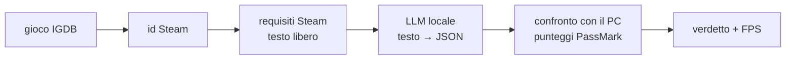

# "Posso farlo girare?"

## In breve

L'utente salva le specifiche del suo PC (CPU, GPU, RAM, VRAM, sistema operativo) e nella pagina di un gioco l'app gli dice **se il gioco gira** e **con quanti FPS circa**, per ogni preset e risoluzione.



L'idea è dividere il lavoro in due:

- **la parte "sporca" la fa l'LLM**: i requisiti di Steam sono testo scritto a mano da ogni sviluppatore (`Intel Core i5-4460 or AMD FX-6300`, `Dual core 2.4 GHz`...), e un parser a regole si romperebbe al primo gioco scritto in modo diverso.
Data l'imprevedibilità del testo, considerando che il parser creato è molto leggero ho deciso di usare un L'LLM che lo trasformi in JSON. Nei test che ho fatto l'LLM si è rivelato molto efficiente anche se caricato in locale sulla mia 4060 8gb
- **la decisione la prende il codice**: confronto e stima sono regole semplici che si possono leggere e controllare. All'LLM non chiediamo mai "gira o no".

Steam e l'LLM sono lenti, quindi i risultati restano in cache su Redis per 30 giorni.

## Perché così

- **Steam** perché IGDB non ha i requisiti di sistema, e l'API `appdetails` di Steam è pubblica e senza chiave.
- **Non** ci sono siti pubblici che facciano una cosa simile senza limiti di divulgazione.
- **LLM locale (Ollama, `qwen3:8b`)** invece di un'API cloud: Risultati molto soddisfacenti e I dati rimangono in locale e non vengono ceduti ad aziende di terze parti.
- **PassMark** per i punteggi: ha migliaia di CPU e GPU, anche quelle vecchie che compaiono nei requisiti. Non c'è un'API, abbiamo copiato le classifiche in `data/hardware/` e le abbiamo convertite in JSON (uso solo didattico).
Le misure fatte da PassMark sono molto affidabili e il sistema di punteggio permette di fare operazioni matematiche per stabilire la potenza di combinazioni di hardware in modo sufficientemente preciso

## Come funziona

### 1. Da IGDB a Steam

IGDB ha una tabella che collega i giochi agli store. Si cerca l'id Steam del gioco, e se non c'è prova a cercare edizioni alternative del gioco, a volte steam le categorizza diversamente.

### 2. Requisiti da Steam

Steam restituisce minimi e consigliati in HTML. Si tolgono i tag e resta il testo. Se il gioco non ha requisiti PC la route risponde 404.

### 3. Estrazione con l'LLM

A Ollama si passa uno JSON Schema, e lui è costretto a rispondere esattamente in quella forma. Temperatura a 0, così lo stesso testo dà sempre lo stesso risultato.

Il problema è che l'LLM può inventare. Per questo ogni valore passa da un controllo dopo la conversione:

- un modello di CPU/GPU si accetta solo se esiste nella tabella dei punteggi e i suoi numeri compaiono nel testo originale (se il testo dice GTX 960 e l'LLM risponde GTX 970, si scarta)
- RAM, VRAM, GHz ecc. devono essere numeri plausibili e comparire nel testo

Molti giochi però scrivono roba generica ("Dual Core 2.4 GHz", "Intel Core i5", "scheda da 512 MB"). Per questi c'è una piccola tabella di modelli di riferimento, fatta guardando i requisiti dei ~1000 giochi più giocati su Steam. Esempio: "Intel Core i5" senza numero diventa un i5-4590. Il risultato viene segnato come stimato.

### 4. Confronto

CPU e GPU si confrontano con i punteggi PassMark (per la CPU il single-thread, che nei giochi conta di più). Prima i nomi vanno normalizzati, perché nessuno li scrive uguale:

```
"NVIDIA GeForce RTX 4060 Laptop GPU"   →  rtx4060laptop
"Intel(R) Core(TM) i5-4460 @ 3.20GHz"  →  i54460
```

Una componente passa se il PC dell'utente arriva almeno al 90% del richiesto. Se i requisiti danno più alternative si prende la più debole.

Il verdetto è uno tra: **consigliati**, **minimi**, **non gira**, **sconosciuto** (per esempio quando una GPU non si trova).

### 5. Stima degli FPS

Partiamo da un'ipotesi: con la CPU e la GPU consigliate un gioco fa circa **100 FPS a 1080p in high**. Questa ipotesi viene rappresentata nel codice con le variabili BASE_ESTIMATES: .fps-estimate.ts:43  Se la GPU dell'utente ha un punteggio 1,5 volte quello consigliato, farà **circa** 1,5 volte tanto.

Da lì:

- si calcolano a parte gli FPS che farebbe la GPU e quelli che farebbe la CPU, e vince **il più basso** (il collo di bottiglia)
- la risoluzione pesa solo sulla GPU, il preset pesa molto sulla GPU e poco sulla CPU
- tetto a 240 FPS, e un taglio se la RAM è sotto il minimo

Le costanti (quanto pesa il preset, quanto pesa la risoluzione) sono in `lib/can-i-run/fps-estimate.ts`. Oltre al numero diamo una fascia (`60-90`, `90-144`...), che è più onesta visto l'errore.

## Quanto è precisa

Abbiamo registrato 37 sessioni di gioco con CapFrameX su un nostro portatile (11 giochi) e con `scripts/calibrate-fps.ts` abbiamo confrontato le stime con gli FPS veri. 
Grazie a queste sessioni di test abbiamo affinato le fvariabilin globali e raggiunto una sogli adi errore accettabile.

Oggi **l'errore medio è intorno al 26%**. Quasi tutto dipende dal gioco: con la stessa GPU consigliata alcuni giochi fanno 50 FPS e altri 200, perché ogni sviluppatore scrive i consigliati come gli pare. Con costanti uguali per tutti di più non si fa.

## Limiti


-Il calcolo funziona bene, lunico limite sono le ancore BASE_ESTIMATES che sono basate solo sulle mie sessioni.
L'idea per superare questo limite è far caricare agli utenti le loro sessioni CapFrameX e ricavare un'ancora BASE_ESTIMATE per ogni singolo gioco basandosi sull'evidenza dei dati e non su supposizioni fatte da noi. 
Simulandolo sulle nostre catture l'errore scende a circa il 10%, ma non c'è stato il tempo di farlo.

- Se Steam scrive solo "scheda compatibile DirectX 11", il risultato è sconosciuto.
- Per i giochi che hanno solo i minimi la stima è pessimista: l'ancora dei minimi non l'abbiamo potuta tarare.
- La prima richiesta su un gioco nuovo è lenta (Steam + LLM): pochi secondi con la GPU ma anche più di un minuto senza.