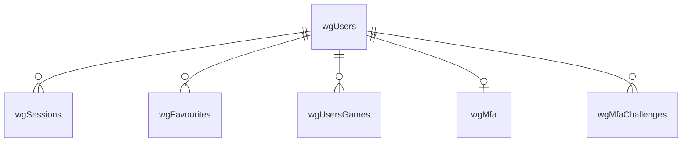

# Database

## In breve

I dati che contano stanno in **PostgreSQL 17**, i dati temporanei in **Redis**. Il backend parla con Postgres tramite **Prisma**.

I giochi **non** sono nel nostro database: arrivano da IGDB. Noi salviamo solo l'id IGDB del gioco accanto all'utente, quindi le tabelle sono poche:

- `wgUsers`: gli utenti (più le specifiche del PC, in una colonna JSON)
- `wgSessions`: i login attivi
- `wgFavourites`: i preferiti
- `wgUsersGames`: la collezione, con lo stato del gioco (da giocare, in corso, finito, da comprare)
- `wgMfa` e `wgMfaChallenges`: la verifica in due passaggi

Lo schema sta in `prisma/schema.prisma` nel backend, e si cambia **solo** con le migrations di Prisma. Le query stanno tutte in `query/`, un file per argomento, e le route le chiamano senza scrivere SQL.

## Perché Postgres, Prisma e Redis

**Postgres invece di SQL Server Express.** Il subject lo permette se si motiva. Gira in Docker su Linux senza problemi (e noi sviluppiamo su Linux), ha i tipi che ci servivano (`JSONB`, `INET`, enum, date con fuso orario, `CHECK`), è gratis senza limiti di dimensione, e lo conoscevamo già.

**Prisma.** Il backend è in TypeScript, quindi niente Entity Framework. Prisma genera un client tipizzato dallo schema: se una query usa una colonna che non esiste, l'errore esce in compilazione. Le query sono parametrizzate (niente SQL injection) e ogni modifica allo schema diventa un file SQL che si può leggere e correggere prima di applicarlo.

**Redis.** Rate limit e cache di "Posso farlo girare?" scadono da soli e si possono ricalcolare. Non ha senso tenerli in Postgres.

## Schema



Le scelte che contano:

- **Preferiti e collezione hanno chiave primaria `(user_id, game_id)`.** Lo stesso gioco non può entrare due volte, e lo garantisce il DB, non il codice. Nella collezione questo vuol dire anche che un gioco ha un solo stato: cambiare stato aggiorna la riga.
- **Niente chiave esterna sul gioco**, perché i giochi non sono da noi. C'è solo un `CHECK (game_id > 0)`, e il backend controlla su IGDB che il gioco esista prima di aggiungerlo.
- **Tutto è in cascata sull'utente.** Se uno cancella l'account spariscono sessioni, preferiti, collezione e 2FA.
- **Specifiche del PC in `JSONB`** su `wgUsers` e non in una tabella a parte: un utente ha un PC, si legge e si scrive tutto insieme, non ci si fanno ricerche dentro.
- **Mai segreti in chiaro.** Della password c'è l'hash argon2, delle sessioni e dei codici 2FA solo l'hash. Chi legge le tabelle non può entrare con quei dati.
- **Wishlist dentro la collezione.** Lo stato `to_buy` fa da wishlist (bonus del subject), senza una tabella in più.

Convenzioni: tabelle con prefisso `wg` (evita nomi tipo `users` o `sessions`), colonne in snake_case nel DB e camelCase nel codice, date tutte `TIMESTAMPTZ`.

## Migrations

Il flusso, con `make dev` avviato:

1. si cambia `schema.prisma`
2. `make migration name=qualcosa` crea il file SQL **senza** applicarlo
3. si rilegge il file e si aggiungono a mano i `CHECK`, che Prisma non sa generare
4. `make migrate` la applica e rigenera il client
5. si committano schema e migration sul branch del backend

Gli altri non devono fare niente: all'avvio il backend esegue `prisma migrate deploy` e applica solo quelle che mancano.

## Connessione

`lib/db/db-pool.ts` crea un pool `pg` (max 10 connessioni, timeout sulle query) e un `PrismaClient` sopra. In sviluppo Next ricarica i moduli a ogni modifica, quindi pool e client si salvano in `globalThis` per non aprirne uno nuovo ogni volta.

Le variabili sono le `DB_*` del `.env`. Anche `prisma.config.ts` (usato dalla CLI per le migrations) costruisce l'URL da lì, così non c'è una `DATABASE_URL` da tenere allineata.

## Query

Le route validano l'input e controllano login e rate limit, poi chiamano le funzioni in `query/`. Le query fanno solo database. Ogni file inizia con `import "server-only"`, così se qualcuno le importa nel codice client la build si rompe.

| File | Cosa c'è |
| --- | --- |
| `users.ts` | trovare, creare e cancellare utenti |
| `sessions.ts` | token di sessione, creazione, ricerca, logout, cookie |
| `favourites.ts` | aggiungi, togli, lista paginata, conteggio |
| `collection.ts` | stato di un gioco, lista per stato, conteggio |
| `pcSpecs.ts` | salva, leggi, cancella le specifiche del PC |
| `mfa.ts` | attiva/disattiva 2FA e gestione dei codici OTP |

Regole che valgono ovunque:

- **Aggiungere due volte non dà errore** (`upsert`), togliere una cosa che non c'è nemmeno (`deleteMany`).
- **L'hash della password non esce mai**, tranne in `findUserByEmail` che serve al login.
- **Le liste sono ordinate per data e poi per `gameId`**, così con la paginazione non si ripetono o saltano giochi che hanno la stessa data.

### Il caso dei codici 2FA

Un codice OTP non deve poter essere usato due volte, nemmeno se arrivano due richieste nello stesso istante. Invece di bloccare la riga con `SELECT ... FOR UPDATE`, l'`UPDATE` ripete tutte le condizioni di validità nella `WHERE` e poi si guarda quante righe ha toccato:

```sql
UPDATE "wgMfaChallenges"
SET    last_used_at = now()
WHERE  id = $1 AND user_id = $2
  AND  last_used_at IS NULL
  AND  expires_at > now()
  AND  attempts < $3;
-- 1 riga: codice accettato. 0 righe: rifiutato.
```

Postgres aggiorna la riga una volta sola, quindi la seconda richiesta trova 0 righe e viene rifiutata. Lo stesso trucco vale per il contatore dei tentativi sbagliati.

Sessioni e codici scaduti li cancella un job ogni ora (`lib/db/cleanup.ts`, avviato da `instrumentation.ts`).

## Cose rimaste aperte

- `wgSessions.ip` è `INET NOT NULL`: se arriva un IP non valido, il login va in errore. Si risolve insieme al problema dell'IP descritto in [Backend.md](Backend.md#problemi-noti).
