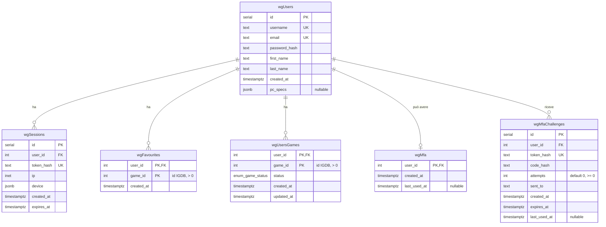

# Database

Questo documento descrive il livello dati di Gaming Explorer: perché abbiamo scelto PostgreSQL e Prisma, com'è fatto lo schema, come si gestiscono le migrations e quali query usa il backend.

Il codice sta nel worktree `app/02_backend` (branch `backend_ts`):

| Percorso | Contenuto |
| --- | --- |
| `prisma/schema.prisma` | Schema dei dati: tabelle, relazioni, enum |
| `prisma/migrations/` | Migrations SQL, applicate in ordine |
| `prisma.config.ts` | Configurazione della CLI di Prisma: costruisce l'URL del DB dalle variabili `DB_*` |
| `lib/db/db-pool.ts` | Pool di connessioni `pg` e client Prisma usati a runtime |
| `query/` | Tutte le query del backend, un file per argomento |

## Scelte tecnologiche

### PostgreSQL al posto di SQL Server Express

Il subject suggerisce SQL Server Express ma permette altri RDBMS se si motiva la scelta. Abbiamo scelto **PostgreSQL 17** per questi motivi:

- **Gira in Docker su Linux senza problemi.** Tutto il progetto si avvia con Docker (vedi [Infrastruttura.md](Infrastruttura.md)) e il gruppo sviluppa su Linux. L'immagine ufficiale `postgres:17` è leggera e parte in pochi secondi.
- **Ha tipi nativi che ci servono:** `JSONB` per le specifiche del PC, `INET` per l'IP delle sessioni, `ENUM` per lo stato dei giochi, `TIMESTAMPTZ` per date con fuso orario, vincoli `CHECK`.
- **È open source e gratuito**, senza limiti di dimensione del database (SQL Server Express si ferma a 10 GB).
- **Lo conoscevamo già:** chi ha curato il DB lavora con `psql`, e le migrations di Prisma sono file SQL che si leggono e si correggono a mano.

### Prisma come ORM

Il backend è in TypeScript (Next.js usato solo come API), quindi al posto di Entity Framework usiamo **Prisma 7**:

- Lo schema sta in un solo file (`schema.prisma`), da cui Prisma genera un client **tipizzato**: se una query usa una colonna che non esiste, l'errore esce in compilazione e non a runtime.
- Le query sono parametrizzate da Prisma, quindi non sono esposte a SQL injection.
- Ogni modifica allo schema produce una **migration in SQL puro**, versionata in Git. Si legge prima di applicarla e si può completare a mano (lo facciamo per i `CHECK`, che Prisma non sa esprimere).
- Prisma si collega a Postgres tramite l'adapter `@prisma/adapter-pg`, sopra un `Pool` di `pg` configurato da noi (vedi [Connessione al database](#connessione-al-database)).

### Redis per i dati temporanei

I dati che possono scadere non stanno in Postgres ma in **Redis**: rate limit e cache della funzione "Posso farlo girare?" (vedi [CanIRun.md](CanIRun.md)). Se Redis perde i dati non si perde nulla di importante, perché si possono ricalcolare.

## Schema



### Convenzioni

| Dove | Convenzione | Esempio |
| --- | --- | --- |
| Modelli Prisma | prefisso `WG_` e PascalCase | `WG_Favourite` |
| Tabelle | prefisso `wg` e camelCase, con `@@map` | `wgFavourites` |
| Colonne | snake_case, con `@map` | `created_at` |
| Campi nel codice | camelCase | `createdAt` |
| Date | `TIMESTAMPTZ(3)`: con fuso orario e precisione al millisecondo | |

Il prefisso `wg` evita conflitti con nomi riservati o generici (`users`, `sessions`).

### Tabelle

**`wgUsers`: utenti registrati**

Contiene solo i dati che servono all'accesso e al profilo: `username` ed `email` unici, l'hash della password (mai la password in chiaro), nome e cognome. La colonna `pc_specs` è facoltativa e contiene le specifiche del PC dell'utente, usate da "Posso farlo girare?".

`pc_specs` è un `JSONB` e non una tabella separata perché:
- ogni utente ha al massimo un PC;
- si legge e si scrive sempre tutto insieme;
- non si fanno ricerche sui singoli campi.

Esempio di valore:

```json
{ "cpu": "AMD Ryzen 7 7435HS", "gpu": "GeForce RTX 4060 Laptop GPU", "ramGb": 16, "vramGb": 8, "os": "Windows 11" }
```

**`wgSessions`: sessioni di login**

Una riga per ogni login. Nel DB si salva l'**hash SHA-256** del token, non il token: chi legge la tabella non può usare le sessioni. Il token vero sta solo nel cookie del browser. `expires_at` deve essere successivo a `created_at` (`CHECK`). L'indice su `user_id` serve a trovare le sessioni di un utente.

**`wgFavourites`: preferiti (funzionalità obbligatoria)**

- **Chiave primaria composta `(user_id, game_id)`**: lo stesso gioco non può comparire due volte tra i preferiti dello stesso utente. Lo garantisce il DB, non il codice.
- **`CHECK (game_id > 0)`**: gli id di IGDB sono sempre interi positivi.
- **Nessuna chiave esterna sul gioco**: i giochi non stanno nel nostro DB ma su IGDB. Prima di aggiungere un preferito, il backend verifica su IGDB che il gioco esista.
- `created_at` serve a ordinare la lista dal più recente.

**`wgUsersGames`: collezione personale**

Stessa struttura dei preferiti, più uno **stato** del gioco preso dall'enum `enum_game_status`:

| Valore nel DB | Valore in Prisma | Significato |
| --- | --- | --- |
| `to_play` | `TO_PLAY` | da giocare |
| `playing` | `PLAYING` | in corso |
| `finished` | `FINISHED` | finito |
| `to_buy` | `TO_BUY` | da comprare (fa da wishlist, uno dei bonus del subject) |

Un gioco ha un solo stato per utente, perché la chiave primaria `(user_id, game_id)` lo impone: cambiare stato vuol dire aggiornare la riga, non aggiungerne un'altra. `updated_at` si aggiorna da solo a ogni modifica (`@updatedAt`). L'indice `(user_id, status)` rende veloce la query più frequente, "i giochi di questo utente con questo stato".

**`wgMfa` e `wgMfaChallenges`: verifica in due passaggi**

- `wgMfa` ha una riga per ogni utente con la 2FA attiva. La chiave primaria è `user_id`, quindi al massimo una riga per utente. `last_used_at` registra l'ultima verifica riuscita.
- `wgMfaChallenges` contiene i codici OTP inviati via email. Anche qui si salvano solo gli hash: `token_hash` del cookie temporaneo e `code_hash` del codice. `attempts` conta i tentativi sbagliati, `last_used_at` dice se il codice è già stato usato.
- Vincoli aggiunti a mano: `attempts >= 0`, `expires_at > created_at`, `last_used_at > created_at`, `token_hash` unico.

### Cancellazioni a cascata

Tutte le tabelle che dipendono dall'utente hanno la chiave esterna su `wgUsers.id` con `ON DELETE CASCADE ON UPDATE CASCADE`. Se un utente cancella l'account spariscono anche le sue sessioni, i preferiti, la collezione e i dati 2FA, senza lasciare righe orfane.

## Migrations

### Come si lavora

Il database **si modifica solo con le migrations**, mai a mano con `psql`. Il flusso, con lo stack di sviluppo avviato (`make dev`):

1. Si modifica `prisma/schema.prisma`.
2. `make migration name=descrizione` crea il file SQL **senza applicarlo** (`prisma migrate dev --create-only`).
3. Si rilegge il file e, se serve, si aggiungono a mano i vincoli che Prisma non genera (`CHECK`).
4. `make migrate` applica la migration e rigenera il client Prisma.
5. Si committano schema e migration sul branch del backend.

Agli altri membri del gruppo non serve fare nulla: all'avvio del container il backend esegue `prisma migrate deploy`, che applica solo le migrations mancanti. Prisma tiene traccia di quelle già applicate nella tabella `_prisma_migrations`. `make migrate_status` mostra cosa manca.

I comandi `make` restituiscono all'utente la proprietà dei file creati dal container (`chown`), così si possono modificare e committare senza `sudo`.

### Cronologia

| Migration | Cosa fa |
| --- | --- |
| `20261106230333_create_user_table` | Prima tabella utenti (`users`) |
| `20261106233648_create_sessions_table` | Tabella `sessions`, `password_hash` portato a `TEXT` |
| `20261106234727_create_sessions_table` | Rinomina con prefisso: `users` → `wgUsers` |
| `20261107114651_create_favourites_table` | `sessions` → `wgSessions`, nuova tabella `wgFavourites` |
| `20261107115435_correzione_tipo_dato_wg_user` | `wgUsers.created_at` passa a `TIMESTAMPTZ` |
| `20261107150331_create_system_collection` | Enum dello stato e tabella `wgUsersGames`; `CHECK` a mano su `game_id > 0` (collezione e preferiti) e su `expires_at > created_at` (sessioni) |
| `20261107150952_create_system_collection` | Corregge il nome di un vincolo |
| `20261109133449_added_pc_specs` | Colonna `pc_specs JSONB` su `wgUsers` |
| `20261111220628_mfa_challenges_create_tables` | Tabelle `wgMfa` e `wgMfaChallenges` con i loro `CHECK`; aggiunge `finished` e `to_buy` all'enum |
| `20261113143753_rimozione_status_completed` | Toglie `completed` dall'enum (sostituito da `finished`) |

Le prime migrations creano e poi ricreano le tabelle con il prefisso `wg`. In quel momento il DB era vuoto, quindi non si è perso nessun dato.

## Connessione al database

`lib/db/db-pool.ts` crea una sola volta:

- un `Pool` di `pg` con i parametri del `.env` (`DB_USER`, `DB_PASSWORD`, `DB_HOST`, `DB_PORT`, `DB_NAME`) e limiti modificabili da variabili facoltative: massimo 10 connessioni, timeout di connessione 5 s, timeout delle query 15 s;
- un `PrismaClient` che usa quel pool tramite `PrismaPg`.

In sviluppo Next.js ricarica i moduli a ogni modifica. Per non aprire un pool nuovo a ogni ricaricamento, pool e client si salvano in `globalThis` e si riusano.

`prisma.config.ts` costruisce l'URL di connessione per la CLI di Prisma (migrations) dalle stesse variabili `DB_*`. Così la configurazione è una sola, e nel `.env` non serve una `DATABASE_URL` separata.

Tutti i file delle query iniziano con `import "server-only"`: se per errore venissero importati in codice che gira nel browser, la build fallirebbe.

## Query

Le query sono separate dalle route: le route (`app/api/...`) validano l'input e controllano autenticazione e rate limit, poi chiamano queste funzioni. Le query si occupano solo del database.

Scelte comuni a tutti i file:

- **Aggiungere è idempotente.** `addFavourite`, `setGameStatus` ed `enableMfa` usano `upsert`: se la riga c'è già non danno errore.
- **Rimuovere non fallisce se la riga non c'è.** `removeFavourite` e `removeFromCollection` usano `deleteMany`, che restituisce `{ count }` invece di lanciare un errore.
- **L'hash della password non esce mai.** Le query che restituiscono un utente lo tolgono con `omit: { passwordHash: true }`. L'unica eccezione è `findUserByEmail`, che serve al login per verificare la password.
- **Ordinamento stabile per la paginazione.** Le liste sono ordinate per data e poi per `gameId`: se due righe hanno la stessa data, le pagine non ripetono e non saltano giochi.

### `query/users.ts`

| Funzione | Restituisce | Note |
| --- | --- | --- |
| `findUserById(id)` | utente senza hash, o `null` | |
| `findUserByEmail(email)` | utente con hash, o `null` | solo per il login |
| `createUser({ username, email, passwordHash, firstName, lastName })` | utente senza hash | se email o username esistono già, Prisma lancia l'errore `P2002` |
| `deleteUser(id)` | utente cancellato | la cascata cancella tutti i suoi dati |

### `query/sessions.ts`

| Funzione | Restituisce | Note |
| --- | --- | --- |
| `generateSessionToken()` | stringa | 32 byte casuali in base64url |
| `hashSessionToken(token)` | stringa esadecimale | SHA-256; nel DB va solo questo |
| `createSession({ userId, tokenHash, ip, device, expiresAt })` | sessione | |
| `findValidSession(tokenHash)` | sessione con l'utente (senza hash), o `null` | `null` anche se scaduta |
| `deleteSession(tokenHash)` | sessione cancellata | logout |
| `setLoginCookie(res, token)` | | cookie `httpOnly`, `sameSite: lax`, `secure` in produzione, 30 giorni |

### `query/favourites.ts`

| Funzione | Restituisce | Note |
| --- | --- | --- |
| `addFavourite(userId, gameId)` | riga | idempotente |
| `removeFavourite(userId, gameId)` | `{ count }` | 0 se non era tra i preferiti |
| `listFavourites(userId, page?)` | righe, dal più recente | `page = { limit, offset }` per la paginazione |
| `countFavourites(userId)` | numero | per sapere quante pagine ci sono |
| `isFavourite(userId, gameId)` | `boolean` | per il cuore nella pagina del gioco |

### `query/collection.ts`

| Funzione | Restituisce | Note |
| --- | --- | --- |
| `setGameStatus(userId, gameId, status)` | riga | crea la riga o cambia lo stato |
| `removeFromCollection(userId, gameId)` | `{ count }` | |
| `listCollection(userId, status?, page?)` | righe, dall'ultima modificata | senza `status`, tutta la collezione |
| `countCollection(userId, status?)` | numero | |
| `getGameStatus(userId, gameId)` | `{ status }` o `null` | |

Esempi:

```ts
listCollection(3)                                        // tutta la collezione
listCollection(3, "PLAYING")                             // solo i giochi in corso
listCollection(3, "PLAYING", { limit: 20, offset: 40 })  // in corso, dal 41° al 60°
countCollection(3, "TO_BUY")                             // quanti da comprare
```

### `query/pcSpecs.ts`

| Funzione | Restituisce | Note |
| --- | --- | --- |
| `setPcSpecs(userId, specs)` | `{ pcSpecs }` | sovrascrive le specifiche precedenti |
| `getPcSpecs(userId)` | `PcSpecs` o `null` | |
| `clearPcSpecs(userId)` | utente | mette la colonna a `NULL` (`Prisma.DbNull`) |

Il tipo `PcSpecs` è `{ cpu, gpu, ramGb, vramGb?, os }`. I valori li valida la route `POST /api/specs/add-specs` prima di chiamare `setPcSpecs`.

### `query/mfa.ts`

Gestione della 2FA:

| Funzione | Restituisce | Note |
| --- | --- | --- |
| `findMfaByUserId(userId)` | riga o `null` | se non è `null`, l'utente ha la 2FA attiva |
| `enableMfa(userId)` | riga | idempotente |
| `disableMfa(userId)` | due `{ count }` | in una transazione cancella anche tutte le challenge |

Login con 2FA:

| Funzione | Restituisce | Note |
| --- | --- | --- |
| `createMfaChallenge({ userId, tokenHash, codeHash, sentTo })` | challenge | in una transazione cancella le challenge vecchie dell'utente, così ce n'è al massimo una; scade dopo 15 minuti |
| `findValidChallenge(tokenHash, maxAttempts)` | challenge o `null` | `null` se scaduta, già usata o senza tentativi |
| `addFailedAttempt(id, maxAttempts)` | `boolean` | +1 ai tentativi; `false` se nel frattempo non era più valida |
| `consumeChallenge(id, userId, maxAttempts)` | `boolean` | segna la challenge come usata e aggiorna `wgMfa.last_used_at` nella stessa transazione |
| `deleteExpiredChallenges()` | `{ count }` | pulizia delle challenge scadute |

Funzioni di supporto: `generateOTP()` (6 cifre con `crypto.randomInt`), `hashOTP(otp)` (HMAC-SHA256 con il segreto `OTP_PEPPER`), `hashCmp(a, b)` (confronto a tempo costante). Costante `MFA_MAX_ATTEMPTS = 5`.

Ordine di verifica di un codice: `findValidChallenge` → confronto con `hashCmp` → se il codice è sbagliato `addFailedAttempt`, se è giusto `consumeChallenge`. Se una delle due restituisce `false`, il login va rifiutato.

**Perché niente `SELECT ... FOR UPDATE`.** `addFailedAttempt` e `consumeChallenge` ripetono tutte le condizioni di validità dentro la `WHERE` dell'`UPDATE` e controllano quante righe sono state aggiornate. Se arrivano due richieste insieme con lo stesso codice, Postgres aggiorna la riga una volta sola: la prima richiesta trova `count = 1`, la seconda `count = 0` e riceve `false`. Così lo stesso codice non si può usare due volte, senza bloccare la riga a mano.

Ecco in SQL cosa esegue `consumeChallenge`:

```sql
UPDATE "wgMfaChallenges"
SET    last_used_at = now()
WHERE  id = $1 AND user_id = $2
  AND  last_used_at IS NULL
  AND  expires_at > now()
  AND  attempts < $3;
-- 1 riga aggiornata → codice accettato; 0 righe → rifiutato
```

## Punti aperti

- **Pulizia periodica.** `deleteExpiredChallenges` non la chiama ancora nessuno e `deleteExpiredSessions` è commentata: sessioni e challenge scadute restano nelle tabelle. Non è un problema di sicurezza, perché le query le ignorano, ma le tabelle crescono.
- **Logout concorrente.** `deleteSession` usa `delete`, che lancia un errore se la riga è già stata cancellata (due logout insieme). Con `deleteMany` non succederebbe.
- **`wgSessions.ip` è `INET NOT NULL`.** Se l'IP che arriva dalla route non è valido, l'inserimento della sessione fallisce. Conviene validarlo prima o rendere la colonna facoltativa.
- **`query/password.ts`** è un file incompleto che non usa nessuno: va eliminato.
