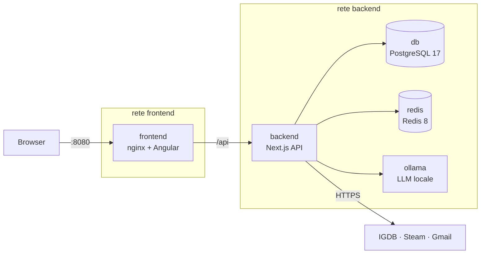

# Infrastruttura

Come si avvia Gaming Explorer, com'è organizzata la repo e come sono configurati i container.

## Requisiti

- Docker con Docker Compose v2 (noi usiamo la 2.40)
- Git e Make
- Un'app registrata su [Twitch Developers](https://dev.twitch.tv/console/apps) per usare [IGDB](https://api-docs.igdb.com). Serve un account Twitch con la verifica in due passaggi attiva; l'app fornisce un Client ID e un Client Secret
- Facoltativo: una GPU NVIDIA con [NVIDIA Container Toolkit](https://docs.nvidia.com/datacenter/cloud-native/container-toolkit/install-guide.html), per far girare l'LLM di "Posso farlo girare?" sulla GPU

## Avvio

```bash
git clone https://github.com/Th3LastCodeBender/TerranovaChallenge-A.L.E..git
cd TerranovaChallenge-A.L.E.
cp .env.example .env
```

Compila `.env` (vedi [Variabili d'ambiente](#variabili-dambiente)), poi:

```bash
make all        # costruisce le immagini e avvia tutto
make llm_pull   # solo la prima volta: scarica il modello dell'LLM (~5 GB)
```

L'applicazione è su <http://localhost:8080>. `make all` aspetta che tutti i servizi risultino sani prima di terminare.

## Sviluppo

```bash
make dev        # oppure make dev_gpu, con l'LLM sulla GPU NVIDIA
```

| Indirizzo | Cosa |
| --- | --- |
| <http://localhost:4200> | Frontend (`ng serve`), con le richieste `/api` inoltrate al backend |
| <http://localhost:3000> | Backend diretto (`next dev`), comodo per Postman e `curl` |

Le modifiche ai sorgenti in `app/` si applicano senza riavviare i container. Il primo avvio richiede qualche minuto per installare le dipendenze: con `make logs` se ne segue l'avanzamento.

- Il frontend chiama il backend con percorsi relativi (`/api/games`, `/api/favourites/...`). Le route nuove devono stare sotto `/api`, altrimenti nginx e il proxy di sviluppo non le inoltrano.
- Il database si modifica solo con le migrations di Prisma: vedi [Database.md](Database.md#migrations).
- Dopo un `pull` che cambia le dipendenze o porta nuove migrations: `make dev_restart`.

## Architettura



| Servizio | Immagine | Ruolo | Porta esposta |
| --- | --- | --- | --- |
| `frontend` | build di `Docker/frontend/frontend.Dockerfile` | nginx serve Angular e inoltra `/api` al backend | `8080` |
| `backend` | build di `Docker/backend/backend.Dockerfile` | Next.js usato solo come API REST | nessuna |
| `db` | `postgres:17` | Database | nessuna |
| `redis` | `redis:8-alpine` | Rate limit e cache | nessuna |
| `ollama` | `ollama/ollama` | LLM locale per leggere i requisiti dei giochi | nessuna |

### Perché così

- **Un solo comando per tutti.** Con Docker ogni membro del gruppo, e chi valuta il progetto, ha le stesse versioni di Node, Postgres e Redis, senza installare nulla oltre a Docker.
- **Due reti separate.** Il frontend sta solo sulla rete `frontend` e il DB solo sulla rete `backend`: anche se nginx venisse compromesso, non potrebbe raggiungere né il database né Redis. Il backend è l'unico servizio su entrambe le reti.
- **Una sola porta aperta.** DB, Redis e Ollama non sono raggiungibili da fuori. Al DB si accede con `make db`, che apre `psql` dentro il container.
- **Stessa origine per pagina e API.** Il browser parla solo con nginx su `:8080`, che inoltra `/api` al backend. Pagina e API hanno lo stesso indirizzo, quindi non serve configurare CORS.

### Avvio in ordine (healthcheck)

Ogni servizio ha un controllo di salute, e chi dipende da un servizio parte solo quando quel servizio è sano:

| Servizio | Controllo | Aspetta |
| --- | --- | --- |
| `db` | `pg_isready` | |
| `redis` | `redis-cli ping` | |
| `ollama` | `ollama list` | |
| `backend` | risponde su `:8080` (fino a 120 s per il primo avvio) | `db` e `redis` |
| `frontend` | | `backend` |

Il backend non aspetta Ollama: serve solo a "Posso farlo girare?", e il resto dell'app deve funzionare anche senza.

Tutti i servizi hanno `restart: unless-stopped`: se un container si blocca, Docker lo riavvia.

## Container

### Backend (produzione)

`Docker/backend/backend.Dockerfile`, un solo stage su `node:24-alpine`:

1. Abilita `pnpm` con corepack e passa all'utente `node` (il container non gira come root).
2. Copia prima solo `package.json` e lockfile e installa le dipendenze con `--frozen-lockfile`. Se cambia solo il codice, Docker riusa questo livello dalla cache e la build è più veloce.
3. Copia il codice, genera il client Prisma ed esegue `next build`. Durante la build Next importa i moduli delle route, e alcuni leggono le variabili del DB e di Redis appena importati: per questo la build riceve valori finti, che non finiscono nell'immagine.
4. All'avvio: `prisma migrate deploy && next start`. Le migrations mancanti si applicano da sole a ogni avvio.

### Frontend (produzione)

`Docker/frontend/frontend.Dockerfile`, due stage:

1. `node:24-alpine` compila Angular.
2. `nginx:alpine` contiene solo i file compilati. Node e i sorgenti restano nel primo stage, che non finisce nell'immagine.

`Docker/frontend/nginx.conf`, montato come volume:

- `location /api/` inoltra al backend e passa `X-Forwarded-For` e `X-Real-IP`, così il backend vede l'IP vero del client (serve al rate limit).
- L'indirizzo del backend è in una variabile con `resolver 127.0.0.11` (il DNS di Docker): nginx lo risolve a ogni richiesta e non solo all'avvio. Così continua a funzionare anche se il container del backend viene ricreato con un IP diverso.
- `try_files $uri $uri/ /index.html`: le rotte di Angular (`/login`, `/game/123`) restituiscono `index.html`, quindi anche il refresh della pagina funziona.

### Sviluppo

`docker-compose.dev.yml` si aggiunge a `docker-compose.yml` e cambia solo frontend e backend:

- **Codice montato come volume** (`./app/02_backend:/app`): `next dev` e `ng serve` vedono le modifiche e ricaricano da soli.
- **`node_modules` e cache (`.next`, `.angular`) in volumi Docker separati**, non nella cartella del progetto. I pacchetti compilati per Alpine non si mescolano con quelli del computer di chi sviluppa.
- Il backend all'avvio esegue `pnpm install`, `prisma generate` e `prisma migrate deploy`, poi `next dev`.
- Il frontend usa `Docker/frontend/proxy.dev.json` per inoltrare `/api` al backend, come fa nginx in produzione.
- Le porte di sviluppo (4200 e 3000) sono legate a `127.0.0.1`: non sono raggiungibili dagli altri computer della rete.

### LLM (Ollama)

- I modelli scaricati restano nel volume `ollama_models` (`qwen3:8b` pesa circa 5 GB) e sopravvivono a `make clean` e `make fclean`.
- `docker-compose.gpu.yml` assegna la GPU NVIDIA al container. Lo usa solo `make dev_gpu`: con `make dev` e `make all` Ollama gira sulla CPU, e la prima analisi di un gioco richiede molto più tempo.

## Variabili d'ambiente

Il file `.env` nella root è l'unica fonte di configurazione: il compose lo passa al backend (`env_file`) e ne usa alcune variabili per DB e Redis. Non va mai committato; il modello è `.env.example`.

| Variabile | Usata da | Note |
| --- | --- | --- |
| `DB_USER`, `DB_PASSWORD`, `DB_NAME` | db, backend | Il compose le passa a Postgres come `POSTGRES_*`. Se mancano, il compose si ferma con un errore |
| `DB_HOST`, `DB_PORT` | backend | `db` e `5432` |
| `REDIS_PASSWORD`, `REDIS_HOST`, `REDIS_PORT` | redis, backend | Redis parte con `--requirepass` |
| `TWITCH_CLIENT_ID`, `TWITCH_CLIENT_SECRET` | backend | Credenziali IGDB |
| `OTP_PEPPER` | backend | Segreto per l'hash dei codici 2FA |
| `EMAIL_CLIENT_ID`, `EMAIL_CLIENT_SECRET` | backend | Indirizzo Gmail e "password per le app", per inviare gli OTP |
| `RATE_LIMIT_DISABLED` | backend | `false` = rate limit attivi (da usare in produzione) |
| `OLLAMA_URL`, `OLLAMA_MODEL` | backend, `make llm_pull` | `http://ollama:11434` e `qwen3:8b` |
| `DB_MAX_CONNECTIONS`, `DB_CONN_TIMEOUT`, `DB_IDLE_TIMEOUT`, `DB_QUERY_TIMEOUT`, `DB_STATEMENT_TIMEOUT` | backend | Facoltative, limiti del pool di connessioni |

## Struttura della repo

Il branch `main` contiene l'infrastruttura. Ogni livello dell'app ha il suo branch, collegato come **git worktree** in `app/`:

| Cartella | Branch | Contenuto |
| --- | --- | --- |
| `.` | `main` | Makefile, compose, `Docker/`, `Documentazione/`, `scripts/` |
| `app/01_frontend` | `frontend` | Angular |
| `app/02_backend` | `backend_ts` | Next.js (solo API), Prisma, query |
| `app/03_db` | `DataBase` | Materiale di studio sul database |

Un worktree è una seconda cartella di lavoro della stessa repo, con un altro branch. Frontend e backend hanno entrambi `src/` e `package.json` nella loro root: così ognuno resta sul suo branch senza conflitti, ma il compose li avvia insieme da `main`. `make setup` crea i worktree, e `make all` e `make dev` lo chiamano in automatico.

I commit fatti dentro una cartella finiscono sul suo branch. Le modifiche a Makefile, compose e documentazione si committano dalla root, su `main`. Prima della consegna i branch vanno importati in `main`, nelle stesse cartelle.

## Comandi

| Comando | Cosa fa |
| --- | --- |
| `make all` | Crea i worktree, costruisce le immagini e avvia la versione da consegnare |
| `make dev` | Avvia la versione di sviluppo |
| `make dev_gpu` | Come `make dev`, con Ollama sulla GPU NVIDIA |
| `make dev_restart` | Riavvia frontend e backend dopo un cambio di dipendenze o nuove migrations |
| `make llm_pull` | Scarica il modello in `OLLAMA_MODEL` (con lo stack avviato) |
| `make down` | Ferma i container e conserva i dati |
| `make re` | Ferma i container e rilancia `make all` |
| `make ps` | Stato dei container |
| `make logs` | Segue i log |
| `make db` | Apre `psql` sul database |
| `make migration name=...` | Crea una migration da `schema.prisma` senza applicarla, per rileggerla |
| `make migrate` | Applica le migrations create e rigenera il client Prisma |
| `make migrate_status` | Mostra quali migrations mancano nel database |
| `make setup` | Crea i worktree mancanti |
| `make status` | Stato Git di tutti i worktree |
| `make pull` | `git pull` in tutti i worktree |
| `make clean_trees` | Rimuove i riferimenti a worktree cancellati |
| `make clean` | Chiede conferma, poi rimuove i container e **cancella i volumi del progetto**: dati del database, `node_modules` e cache di sviluppo. I modelli di Ollama restano |
| `make fclean` | Come `clean`, poi cancella **immagini, cache di build e reti non in uso di tutto Docker**, anche di altri progetti. I modelli di Ollama restano |

`make migration`, `make migrate` e `make migrate_status` funzionano solo con lo stack di sviluppo avviato, perché eseguono la CLI di Prisma dentro il container del backend.

## Limiti noti

- L'immagine del backend di produzione contiene anche le dipendenze di sviluppo ed è pesante. Una build multi-stage con `output: standalone` lo ridurrebbe, ma abbiamo preferito un Dockerfile più semplice.
- Se una migration fallisce all'avvio, il backend non parte e Docker continua a riavviarlo: va letto l'errore con `make logs`.
- `make all` non usa la GPU per Ollama.
