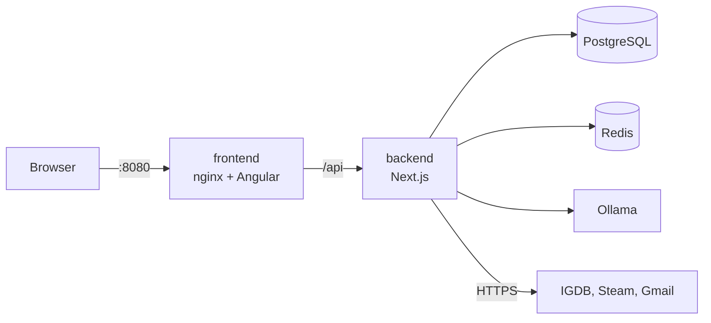

# Infrastruttura

## In breve

Tutto gira in Docker con un solo `docker compose`. Sono cinque container:

- **frontend**: nginx che serve l'Angular già compilato e gira al backend tutto quello che inizia con `/api`.
- **backend**: Next.js con server http in ascolto sulla porta 3000, bindato sulla 8080 della macchina host.
- **db**: PostgreSQL 17, i dati salvati creati per la nostra logica di backend (utenti, preferiti, collezione...), indipendenti da IGDB
- **redis**: rate limit e caching .
- **ollama**: un LLM locale utilizzato per validare i dati sulle specifiche per PC raccomandate da Steam (non normalizzate da Steam, perciò spesso difficilmente interpretabili da un algoritmo di parsing manuale).

Nginx è l'unico punto di accesso all'applicazione sulla porta 8080. Sono configurate 2 reti docker: backend e frontend. Nella prima 

Ci sono due modi di avviarlo:

- `make all`: versione "da consegnare", con immagini costruite e nginx.
- `make dev`: per lavorare, con il codice montato sui container, come volumi, in hot reload, cosi da poter lavorare con cambiamenti dinamici durante lo sviluppo del codice (ng serve per frontend Angular, pnpm exec next dev per il backend)

Il perché di queste scelte è in [Workflow.md](Workflow.md).

## Reti e porte

| Rete | Chi c'è |
| --- | --- |
| `frontend` | frontend, backend |
| `backend` | backend, db, redis, ollama |

DB, Redis e Ollama non hanno porte pubblicate.
Al DB si entra con `make db`, che apre `psql` dentro il container.

Il browser si interfaccia con nginx che fa da proxy per le chiamate, non è necessario quindi configurare CORS.

## Ordine di avvio

Ogni servizio ha un healthcheck e chi dipende da lui aspetta che sia sano:

- `db` e `redis` partono per primi
- `backend` aspetta `db` e `redis`
- `frontend` aspetta `backend`

Ollama è un container autonomo e indipendente: se l'LLM non c'è, il resto dell'app funziona lo stesso.

Tutti hanno `restart: unless-stopped`.

## Le immagini

**Backend** (`Docker/backend/backend.Dockerfile`): `node:24-alpine`, utente non root, prima installa le dipendenze e poi copia il codice (così se cambia solo il codice Docker riusa la cache). All'avvio fa `prisma migrate deploy` e poi `next start`, quindi le migrations nuove si applicano in automatico.

Una cosa strana: `next build` importa i moduli delle route e alcuni leggono le variabili di DB e Redis appena importati. Per questo la build riceve valori finti, che non finiscono nell'immagine.

**Frontend** (`Docker/frontend/frontend.Dockerfile`): due stage. Il primo compila Angular con Node, il secondo è nginx con i file compilati.

**nginx** (`Docker/frontend/nginx.conf`):

- `/api/` va al backend, passando l'IP del client negli header
- il nome del backend si risolve a ogni richiesta (`resolver 127.0.0.11`), così se il container viene ricreato nginx non resta appeso al vecchio IP
- tutto il resto torna `index.html`, così il refresh su `/login` o `/game/123` funziona

## Sviluppo

`docker-compose.dev.yml` si aggiunge sopra al compose normale e cambia solo frontend e backend:

- il codice è montato come volume, `ng serve` e `next dev` ricaricano da soli
- `node_modules` e le cache (`.next`, `.angular`) stanno in volumi Docker, non nella cartella del progetto, così i pacchetti compilati per Alpine non si mescolano con quelli del nostro PC
- `ng serve` usa `Docker/frontend/proxy.dev.json` per girare `/api` al backend, come fa nginx
- le porte 4200 e 3000 sono legate a `127.0.0.1`, non si vedono dalla rete

`docker-compose.gpu.yml` assegna la GPU NVIDIA a Ollama. Lo usano `make dev_gpu` e `make all_gpu`. Il modello sta nel volume `ollama_models`, che non viene cancellato né da `make clean` né da `make fclean`, per evitare di riscaricare 5 GB ogni volta.

## Variabili d'ambiente

Il `.env` nella root è l'unica configurazione. Il compose lo passa intero al backend e ne prende alcune variabili per Postgres e Redis. Il modello da copiare è `.env.example`, il `.env` vero non viene committato.

Il compose si rifiuta di partire se mancano le variabili del DB o la password di Redis.

## Struttura della repo

`main` contiene tutto: l'infrastruttura (Makefile, compose, `Docker/`, documentazione) e il codice dei due livelli.

| Cartella | Da quale branch arriva |
| --- | --- |
| `app/01_frontend` | `frontend` |
| `app/02_backend` | `backend_ts` |

Durante lo sviluppo ogni livello stava sul suo branch, collegato come git worktree dentro `app/`. Per la consegna i due branch sono stati importati in `main` con `git subtree add`, che tiene anche la cronologia dei commit. Il branch `DataBase` non è stato importato: schema e migrations stanno già nel backend (`app/02_backend/prisma/`).

## Comandi

| Comando | Cosa fa |
| --- | --- |
| `make all` / `make all_gpu` | Build e avvio della versione finale, con o senza GPU destinata al modello di OLLAMA |
| `make dev` / `make dev_gpu` | Avvio di sviluppo, con o senza GPU destinata al modello di OLLAMA|
| `make dev_restart` | Riavvia frontend e backend (nuove dipendenze o migrations) |
| `make llm_pull` | Scarica il modello di Ollama |
| `make down` | Ferma tutto, senza eliminare i volumi (i dati persistono) |
| `make re` | `down` + `all` |
| `make ps` / `make logs` | Stato e log |
| `make db` | ingresso container del database con `psql` |
| `make migration name=...` | Crea una migration senza applicarla |
| `make migrate` | Applica le migrations e rigenera il client Prisma |
| `make migrate_status` | Quali migrations mancano |
| `make clean` | Cancella container e volumi del progetto, **compresi i dati del DB** |
| `make fclean` | Come `clean`, più immagini, cache di build e reti inutilizzate **di tutto Docker** |

I comandi delle migrations funzionano solo con `make dev` avviato, perché girano dentro il container del backend. Alla fine restituiscono a noi la proprietà dei file creati, così si committano senza `sudo`.

## Limiti

- L'immagine del backend si porta dietro anche le dipendenze di sviluppo ed è pesante. Con una build multi-stage e `output: standalone` sarebbe più piccola, ma abbiamo preferito un Dockerfile semplice.
- `make all` non usa la GPU per Ollama: per usarla c'è `make all_gpu`.
- Se una migration fallisce il backend non parte e Docker continua a riavviarlo. Necessario l'utilizzo di `make logs` per visualizzare i log del container
.
